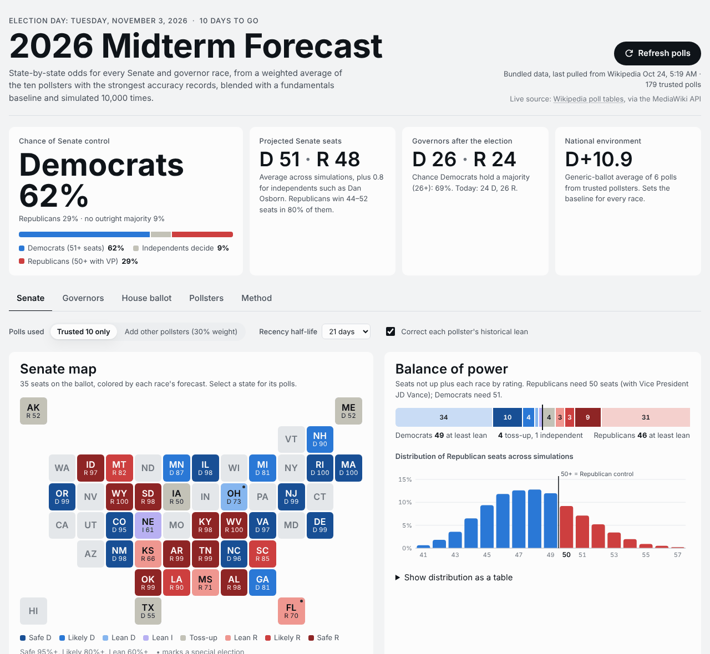
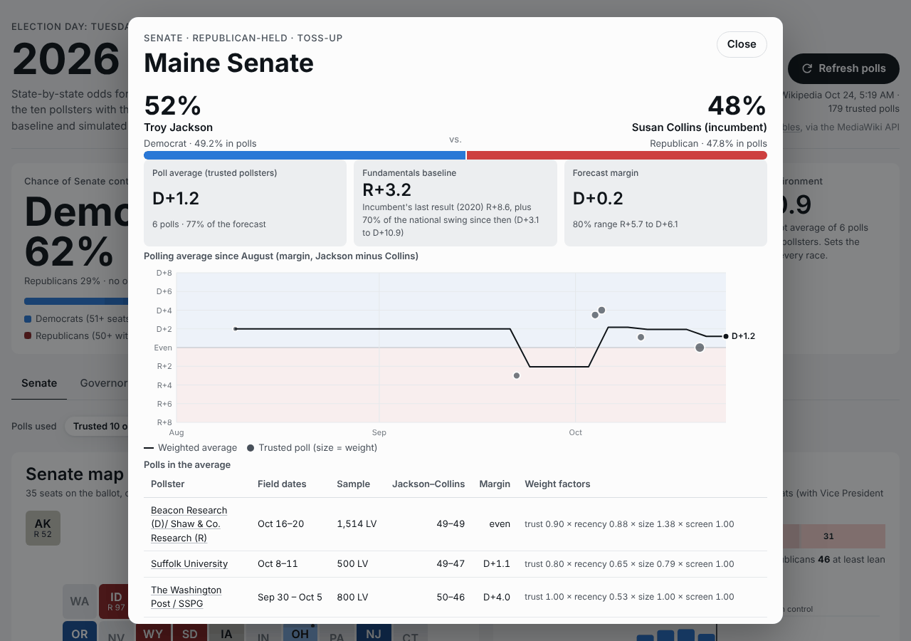

# 2026 Midterm Forecast

A state-by-state forecast for every 2026 Senate and governor race. It's built from a weighted average of the **ten pollsters with the strongest accuracy records**, blended with a fundamentals baseline, and simulated 10,000 times. One click on **Refresh polls** pulls the latest poll tables from Wikipedia and recalculates everything.



## Open it

| Where | How | Live refresh |
|---|---|---|
| **Your computer** | Download the repo and double-click `index.html` (no build, no server needed) | Yes: the browser calls Wikipedia directly |
| **GitHub Pages** | Settings → Pages → *Deploy from a branch* → pick this branch, folder `/ (root)` | Yes, with a fallback to `data/polls.json` |
| **Local server** | `python3 -m http.server 8000`, then open <http://localhost:8000> | Yes, with a fallback to `data/polls.json` |

Command-line tools need Node 18 or newer and no npm install:

```bash
node --test test/*.test.js        # 35 tests: parser, model, data integrity
node scripts/predict.js           # forecast table in the terminal (--all, --json, --as-of YYYY-MM-DD)
node scripts/update-polls.js      # pull Wikipedia polls into data/polls.js and data/polls.json (--dry-run)
node scripts/build-standalone.js  # one self-contained HTML file in dist/
```

## What the dashboard shows

- **Headline odds**: chance each party controls the Senate, projected seats, governorships and the national environment (generic ballot).
- **Senate and Governors tabs**: a tile map colored Safe/Likely/Lean/Toss-up, a balance-of-power bar, the distribution of seat outcomes, and a sortable table of every race. Select any state for its race detail: win probability, poll average versus baseline, a polling-average trend chart, and each poll with its weight broken down factor by factor.
- **House ballot tab**: the generic-ballot average and the polls in it.
- **Pollsters tab**: the ten trusted pollsters, their grades, trust weights, historical lean, and how much of the model each one drives.
- **Settings**: trusted pollsters only, or add every other pollster at reduced weight. Also the recency half-life (7–30 days) and the historical-lean correction. Every chart and number recalculates instantly.



## The ten trusted pollsters

Selection rule: the top-graded firms in [Silver Bulletin's pollster ratings](https://www.natesilver.net/p/pollster-ratings-silver-bulletin) (Nate Silver's continuation of the FiveThirtyEight ratings, which blend historical accuracy with methodological transparency; January 2026 update), limited to firms that still publish 2026 polls for major media.

| # | Pollster | Rating | Trust weight | Historical lean* | Main media partners |
|---|---|---|---|---|---|
| 1 | The New York Times / Siena College | A+ (top 3, Jan 2026) | 1.00 | n/a | The New York Times |
| 2 | The Washington Post (Ipsos / Schar School) | A+ (#1, Jan 2026) | 1.00 | n/a | The Washington Post, ABC News |
| 3 | Marquette Law School Poll | A+ (#2, Jan 2026) | 1.00 | D+0.35 | Wisconsin and national media |
| 4 | AtlasIntel | A+ (#1 in 2025 update) | 1.00 | D+0.16 | Bloomberg |
| 5 | Fox News Poll (Beacon Research / Shaw & Co.) | A | 0.90 | n/a | Fox News |
| 6 | SurveyUSA | A | 0.90 | D+0.09 | Local TV (KSTP and others) |
| 7 | Emerson College Polling | A− | 0.80 | D+0.65 | The Hill, Nexstar |
| 8 | Marist Poll | A− | 0.80 | D+0.52 | NPR, PBS News |
| 9 | Suffolk University | A− | 0.80 | D+0.89 | USA Today, Boston Globe |
| 10 | Quinnipiac University | B+ | 0.70 | D+0.62 | National and regional media |

\* Silver Bulletin's mean-reverted bias, as published in [Media Bias/Fact Check pollster profiles](https://mediabiasfactcheck.com/pollster-sources/): how far the firm's past polls have leaned, in points of margin. "n/a" means no numeric value was available, so no correction is applied.

Ratings belong to the firm that conducts the poll, so its polls for other sponsors count too: Siena's own New York and Texas polls, SurveyUSA's polls for local TV stations, and so on. AtlasIntel has not published polls of these races yet. It stays on the list so its polls count as soon as they appear.

**Left out:** YouGov (B, 77th in the 2025 update), SSRS/CNN (C in the 2025 update), Gallup (no horse-race polls), Monmouth (polling institute closed in 2025), Selzer & Co. (retired from election polling after 2024), and partisan or lower-rated firms (Trafalgar, InsiderAdvantage, Quantus, co/efficient, Rasmussen, campaign-sponsored polls). The settings toggle can add them back at 30% weight, or 15% for party-affiliated polls (marked (D) or (R) on Wikipedia).

Sources for the ratings: [Silver Bulletin January 2026 update](https://www.natesilver.net/p/pollster-ratings-silver-bulletin), [Marquette ranked No. 2 / Washington Post No. 1](https://today.marquette.edu/2026/02/marquette-law-school-poll-again-ranked-no-2-in-annual-national-pollster-ratings/), [AtlasIntel A+ in the 2025 update](https://atlasintel.org/media/atlasintel-has-an-a-rating-and-is-the-no1-pollster-in-america-according-to-the-2025-us-pollster-ratings), [FiveThirtyEight 2024 ratings (NYT/Siena most accurate)](https://scri.siena.edu/2024/02/06/the-new-york-times-siena-college-poll-ranked-most-accurate-pollster-in-america-by-fivethirtyeight-com), and the individual MBFC profiles for [Emerson](https://mediabiasfactcheck.com/emerson-college-polling-bias-and-credibility/), [Marist](https://mediabiasfactcheck.com/marist-poll-bias-and-credibility/), [Suffolk](https://mediabiasfactcheck.com/suffolk-polling-bias-and-credibility/), [Quinnipiac](https://mediabiasfactcheck.com/quinnipiac-poll-bias-and-credibility/), [SurveyUSA](https://mediabiasfactcheck.com/surveyusa-bias-and-credibility/), [Beacon/Shaw](https://mediabiasfactcheck.com/beacon-research-shaw-co-bias/), [Marquette](https://mediabiasfactcheck.com/marquette-university-poll-bias-and-credibility/), [AtlasIntel](https://mediabiasfactcheck.com/atlasintel-polling-bias-and-credibility/) and [Siena](https://mediabiasfactcheck.com/siena-college-research-institute-bias-and-credibility/).

## How the model works

All of this lives in [`js/model.js`](js/model.js), with defaults in `DEFAULTS`.

1. **Weight each poll**

   `weight = trust × recency × sample size × voter screen × repeat discount`

   - *trust*: the pollster's trust weight from the table above.
   - *recency*: `0.5 ^ (days since the poll closed ÷ 21)`. Polls older than 240 days are dropped.
   - *sample size*: `√(n ÷ 800)`, capped at n = 3,000. When a release gives no sample size, n = 600 is assumed.
   - *voter screen*: likely voters 1.00, registered voters 0.85, adults 0.70.
   - *repeat discount*: each newer poll by the same firm halves the weight of its older polls in that race.
2. **Correct historical lean** (optional, on by default): each poll's margin is shifted by the firm's mean-reverted bias. This applies only to Democrat-versus-Republican races.
3. **Fundamentals baseline**: an incumbent's last result plus 70% (Senate) or 50% (governor) of the national swing since then. For open seats, the 2024 presidential margin plus 80% (Senate) or 60% (governor) of the national swing. The swing is measured by the trusted generic-ballot average.
4. **Blend**: the poll average and the baseline are combined by precision. Poll uncertainty is `√(4² + 5² ÷ effective polls)` points of margin. Baseline uncertainty is 9–12 points.
5. **Simulate 10,000 elections**: each one draws a national polling error shared by every race (3 points, fat-tailed) plus a separate error for each race. Republicans keep the Senate at 50 seats (VP JD Vance breaks ties) and Democrats need 51. Independents such as Dan Osborn are tracked separately, so some simulations end with no outright majority.

Ratings: Safe ≥ 95%, Likely ≥ 80%, Lean ≥ 60%, otherwise Toss-up.

## Forecast snapshot (October 24, 2026)

This uses the bundled data after the **Update polls** workflow merged Wikipedia's poll tables (05:19 UTC), with trusted pollsters only and default settings. The dashboard recalculates every time you refresh.

- **Senate control:** Democrats 62%, Republicans 29%, no outright majority 9%. Average seats: D 51.3, R 47.9, independents 0.8.
- **Governors:** Democratic majority 69%. Average 26.5 Democratic governors.
- **National environment:** D+10.9 on the generic ballot (NYT/Siena, Emerson, Marquette, Quinnipiac).

Every race where the leader's chance is below 90%:

| Senate race | Polls | Poll avg | Forecast | Chance |
|---|---|---|---|---|
| Iowa: Turek (D) v Hinson (R) | 11 | D+0.8 | R+0.1 | Toss-up 50/50 |
| Maine: Jackson (D) v Collins (R) | 6 | D+1.2 | D+0.2 | Jackson 52% |
| Alaska: Peltola (D) v Sullivan (R) | 2 | D+6.8 | R+0.3 | Sullivan 52% |
| Texas: Talarico (D) v Paxton (R) | 14 | D+1.6 | D+0.6 | Talarico 55% |
| Nebraska: Osborn (I) v Ricketts (R) | 1 | I+4.0 | I+2.0 | Osborn 61% |
| Kansas: Hamilton (D) v Marshall (R) | 2 | D+0.5 | R+2.2 | Marshall 66% |
| Florida (special): Nixon (D) v Moody (R) | 1 | R+11.7 | R+4.7 | Moody 70% |
| Mississippi: Colom (D) v Hyde-Smith (R) | 0 | – | R+4.6 | Hyde-Smith 71% |
| Ohio (special): Brown (D) v Husted (R) | 8 | D+4.2 | D+2.8 | Brown 73% |
| Michigan: El-Sayed (D) v Rogers (R) | 8 | D+2.6 | D+3.9 | El-Sayed 81% |
| Georgia: Ossoff (D) v Collins (R) | 2 | D+12.8 | D+7.0 | Ossoff 81% |
| Montana: Bodnar (I) v Alme (R) | 0 | – | R+10.0 | Alme 82% |
| South Carolina: Andrews (D) v Graham (R) | 0 | – | R+9.5 | Graham 85% |
| Minnesota: Flanagan (D) v Tafoya (R) | 3 | D+2.5 | D+6.4 | Flanagan 87% |

| Governor race | Polls | Poll avg | Forecast | Chance |
|---|---|---|---|---|
| Nevada: Ford (D) v Lombardo (R) | 1 | D+1.4 | D+3.9 | Ford 70% |
| Alaska: Kreiss-Tomkins (D) v Wilson (R) | 0 | – | R+5.7 | Wilson 71% |
| Georgia: Bottoms (D) v Jackson (R) | 1 | D+5.0 | D+5.2 | Bottoms 71% |
| Florida: Jolly (D) v Donalds (R) | 1 | R+5.7 | R+5.7 | Donalds 72% |
| Ohio: Acton (D) v Ramaswamy (R) | 8 | D+4.4 | D+2.9 | Acton 75% |
| Wisconsin: Crowley (D) v Tiffany (R) | 2 | D+2.9 | D+4.4 | Crowley 76% |
| Texas: Hinojosa (D) v Abbott (R) | 13 | R+3.3 | R+3.5 | Abbott 79% |
| Arizona: Hobbs (D) v Biggs (R) | 0 | – | D+7.5 | Hobbs 80% |
| South Carolina: Johnson (D) v Wilson (R) | 0 | – | R+10.5 | Wilson 85% |
| New Hampshire: Warmington (D) v Ayotte (R) | 1 | R+11.0 | R+7.0 | Ayotte 86% |
| Oregon: Kotek (D) v Drazan (R) | 0 | – | D+10.3 | Kotek 87% |
| Kansas: Holscher (D) v Masterson (R) | 2 | R+6.0 | R+6.8 | Masterson 88% |
| Iowa: Sand (D) v Lahn (R) | 11 | D+8.0 | D+5.4 | Sand 88% |

*Polls* counts every trusted poll from the last 240 days, but old polls carry little weight. Florida's only Senate poll is from March, so that forecast is essentially the baseline. Alaska shows the other side of the blend: one recent poll (Peltola +7) against an incumbent baseline of Sullivan +7 lands near even. Run `node scripts/predict.js` for all 71 races.

## Refreshing the data

**In the dashboard:** *Refresh polls* downloads every race article (72 pages) from the [MediaWiki API](https://en.wikipedia.org/w/api.php) with `origin=*`, which Wikipedia allows from any web page. It then:
1. reads each "Poll source / Date(s) administered / Sample size" table;
2. keeps only tables listing both nominees, which drops primary, hypothetical-matchup and polling-average tables;
3. prefers the likely-voter version of each poll;
4. merges new rows into the dataset and recalculates everything.

A banner lists the new polls, the races that moved, and any page that couldn't be read. Refreshed data is saved in your browser; *Use bundled snapshot* resets it. If Wikipedia can't be reached, the page loads `data/polls.json` instead. In a claude.ai Artifact copy, it reads that file through your GitHub connector.

**In GitHub:** the **Update polls** workflow (Actions tab → *Update polls* → *Run workflow*) runs the same parser in Node and commits refreshed `data/polls.js` and `data/polls.json`. A daily schedule is included in the workflow file, commented out.

## Data and caveats

- `data/polls.js` started as a hand-compiled snapshot (October 24, 2026) of 96 polls from pollster releases and news coverage, 73 of them from the trusted ten, with a source link on every row. The **Update polls** workflow then merged Wikipedia's poll tables: Wikipedia's versions replaced every matching row, so the file now holds 952 polls, 179 from the trusted ten. Nine rows remain hand-compiled: the six national generic-ballot polls and three state polls Wikipedia doesn't list. Rows marked `approx: true` (≈ in the UI) use a release date in place of unpublished field dates.
- Only the trusted ten count by default, so races they have not polled lean on the fundamentals baseline. Turn on *Add other pollsters* to see every public poll's effect.
- No Wikipedia article lists individual national generic-ballot polls this cycle (only aggregator averages), so the national environment comes from the bundled trusted generic-ballot polls; add new ones to `data/polls.js` as `HOUSE-US` rows.
- Ranked-choice Alaska and the three-way Montana Senate race are modeled as the top two candidates.
- Expert ratings shown in race details (Sabato's Crystal Ball, Cook) are context only and do not enter the model.
- This is an independent forecast built from public polls. It is not affiliated with any pollster, news outlet or campaign.

## Project layout

```
index.html               dashboard page (classic scripts, works from file://)
css/dashboard.css        styles, light and dark themes
js/config.js             the ten pollsters, all 71 races, 2024 baselines, tile-map layout
js/model.js              weighting, baseline, blend, Monte Carlo simulation
js/wikipedia.js          MediaWiki fetch, DOM-free poll-table parser, merge logic
js/app.js                rendering, charts, race dialog, refresh flow
data/polls.js            poll dataset (also mirrored to data/polls.json)
scripts/                 update-polls.js, predict.js, build-standalone.js
test/                    node:test suites and Wikipedia-markup fixtures
.github/workflows/       tests on push; one-click "Update polls"
```
